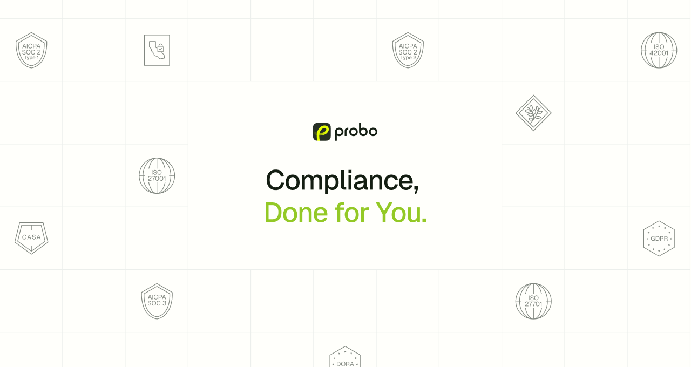

<a href="https://www.probo.com">
  <picture>
    <source media="(prefers-color-scheme: dark)" srcset="cover_v4_dark.png">
    <source media="(prefers-color-scheme: light)" srcset="cover_v4_light.png">
    
  </picture>
</a>

# Probo

Probo is **open-source compliance infrastructure built for agents**. Your
agents get you to **SOC 2, ISO 27001, and GDPR**, on infrastructure you own.
Think Linear for compliance. An open-source alternative to Vanta and Drata.

Compliance is the last back-office job still run on spreadsheets, screenshots,
and consultants billing by the hour. With Probo, every risk, control, vendor,
policy, and piece of evidence is an API call: 270+
[MCP](https://modelcontextprotocol.io) tools, a CLI, and GraphQL. No evidence
screenshots, no questionnaire copy-paste, no compliance tool your engineers
refuse to open. Your agents do the work, and your auditor gets the proof.

```sh
git clone https://github.com/getprobo/probo.git && cd probo
# generate secrets and a .env file: see the self-hosting guide
docker compose -f compose.prod.yaml up -d
```

[Website](https://www.probo.com) ·
[Documentation](https://www.probo.com/docs) ·
[Self-hosting guide](https://www.probo.com/docs/deployment/self-hosting/docker-compose) ·
[Changelog](https://www.probo.com/changelog) ·
**[Talk to a founder](https://www.probo.com/contact)**

**Built for:** agentic compliance workflows · startups chasing their first
SOC 2 · security teams running ISO 27001 · privacy teams handling GDPR ·
engineers automating evidence

## What it looks like

Connect any MCP client (Claude, Cursor, and others) to Probo and ask it to do
the work:

```text
> Review our vendors, flag every one processing personal data without a DPA,
  and open a task for each.

> Draft the ISO 27001 Statement of Applicability from our current controls
  and send it to the CISO for approval.
```

Or script it from the CLI:

```sh
prb risk list
prb internal-control create --name "MFA enforced on all production systems" --category "Security"
prb evidence upload ./screenshot.png --internal-control <id>
```

## Start here

- [Self-host with Docker Compose](https://www.probo.com/docs/deployment/self-hosting/docker-compose) — Probo, PostgreSQL, and object storage on a single host
- [Self-host on Kubernetes](https://www.probo.com/docs/deployment/self-hosting/kubernetes) — Helm chart for production deployments
- [Connect an AI agent over MCP](https://www.probo.com/docs/developers/api/mcp/overview) — setup guides per client
- [CLI reference](https://www.probo.com/docs/developers/cli/overview) — every resource, from the terminal
- [Talk to a founder](https://www.probo.com/contact) — want help getting certified, or a managed instance? We'll walk you through it

## Featured

- [probo](https://github.com/getprobo/probo) — the platform: Go backend, React console, `prb` CLI, GraphQL and MCP APIs.
- [awesome-compliance](https://github.com/getprobo/awesome-compliance) — a curated list of tools, frameworks, and resources for IT compliance.
- Audit roles for [AWS](https://github.com/getprobo/terraform-aws-audit-role), [GCP](https://github.com/getprobo/terraform-gcp-audit-role), and [Azure](https://github.com/getprobo/terraform-azurerm-audit-role) — Terraform modules that grant Probo read-only access for evidence collection.

## Community

- Website: https://www.probo.com
- Discord: https://discord.gg/8qfdJYfvpY
- X: https://x.com/getprobo
- LinkedIn: https://www.linkedin.com/company/getprobo
- Talk to a founder: https://www.probo.com/contact

## Contributing

Pull requests are welcome. Read
[CONTRIBUTING.md](https://github.com/getprobo/probo/blob/main/CONTRIBUTING.md)
first. Commits need a DCO sign-off (`git commit -s`); no CLA required.

Report security issues to [security@probo.com](mailto:security@probo.com), not
in public issues. See
[SECURITY.md](https://github.com/getprobo/probo/blob/main/SECURITY.md).

## License

Probo is licensed under [MIT](https://github.com/getprobo/probo/blob/main/LICENSE).
